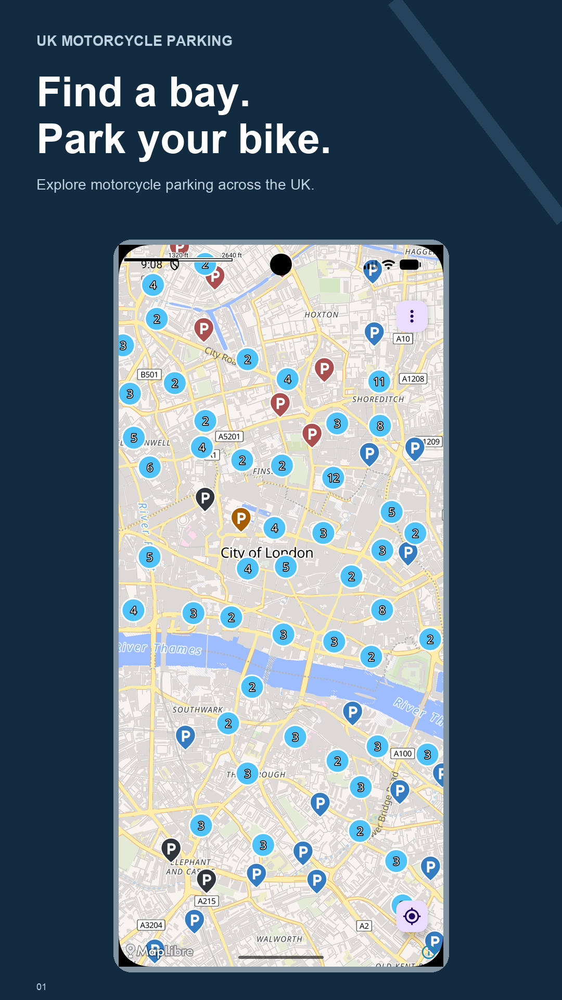
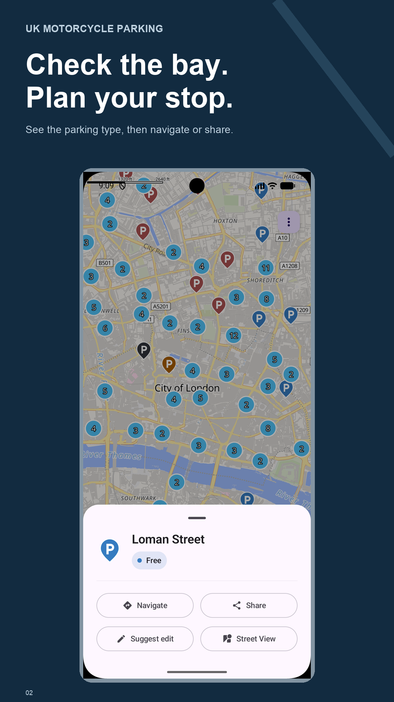
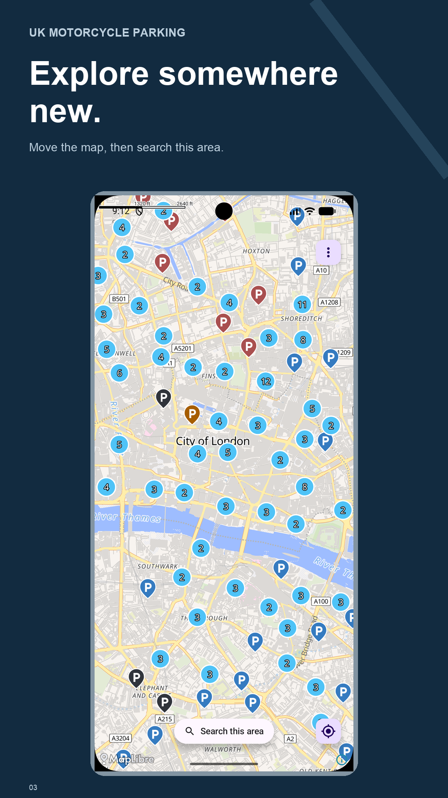
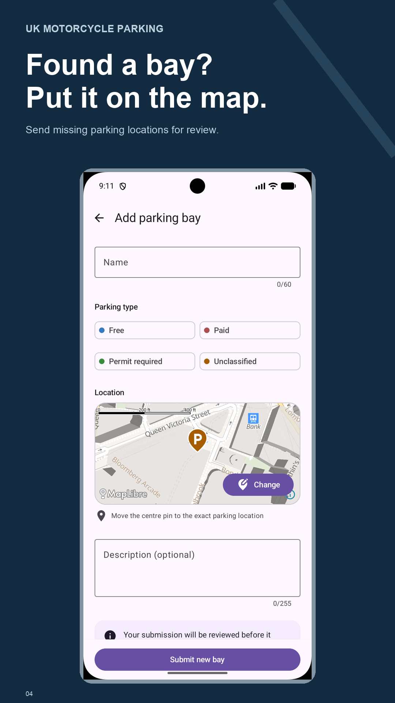
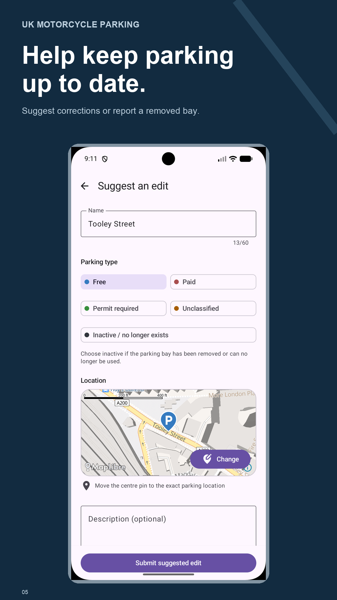
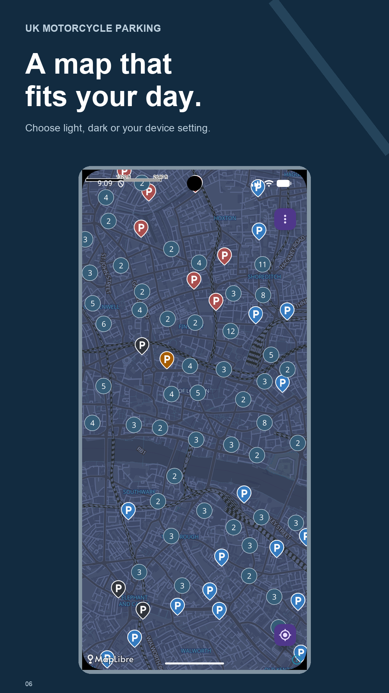

  

# UK Motorcycle Parking

An Android and iOS app for finding motorcycle parking in the UK. Riders can find
bays on a map, check parking restrictions, get directions, and submit missing bays
or corrections for review.

[Google Play](https://play.google.com/store/apps/details?id=com.melashkov.mcparking) ·
[App Store](https://apps.apple.com/gb/app/uk-motorcycle-parking/id6451344073)

  
  
  

  
  
  

## About the project

I started UK Motorcycle Parking in 2013. The first version used Titanium, but keeping
up with API changes and instability became difficult. I rewrote it as native Android
and iOS apps for the second version.

This is the third version, now built with Kotlin Multiplatform. The aim is to bring
the separate SwiftUI and Android apps together, keep their features aligned, and
reduce the work needed to maintain them.

I want to keep the app free and manageable over the long term. Riders add parking
bays when they can, and use the locations others have shared when visiting a new
town or travelling. We help each other find somewhere to park.

## Maps and running costs

Google Maps became too expensive for the project's long-term goal of staying free.
Map loads and place-search requests added running costs as people used the app.
Moving to maps based on OpenStreetMap data makes more sense for this project.

A big thank you to [Zsolt Ero (hyperknot)](https://github.com/hyperknot), who created
[OpenFreeMap](https://openfreemap.org). Its free public map hosting makes this move
possible without taking on the cost and maintenance of hosting map tiles myself.
Thanks also to the OpenStreetMap contributors whose data makes these maps possible.

## Engineering

Android and iOS share Compose UI, ViewModels, domain logic and API access. Platform
implementations handle location permissions, external actions such as directions
and sharing, and app configuration.

The shared code separates UI state, domain rules and data access. ViewModels expose
state through `StateFlow` and accept UI events; use cases depend on a repository
interface. Ktor handles HTTP and serialization, Koin provides dependencies, and
MapLibre renders the map.

A few places to start reading:

- **Map search:** [BaysMapViewModel](./shared/src/commonMain/kotlin/com/melashkov/mcparking/ui/baysMap/BaysMapViewModel.kt)
  loads the initial viewport automatically, then leaves subsequent searches to the
  rider. A [domain rule](./shared/src/commonMain/kotlin/com/melashkov/mcparking/domain/usecases/SearchParkingBaysUseCase.kt)
  prevents requests when the map is zoomed too far out.
- **Async state handling:** [map ViewModel tests](./shared/src/commonTest/kotlin/com/melashkov/mcparking/ui/baysMap/BaysMapViewModelTest.kt)
  cover moving the map during a request, cancellation, empty results and failures.
  [Shared tests](./shared/src/commonTest/kotlin/com/melashkov/mcparking) also cover API
  responses, repository mapping and the bay submission flow.
- **Release tooling:** the [Android release guide](./docs/android-release.md) describes
  crash mappings and native symbol verification. The publishing
  script checks symbol checksums and ELF build IDs against the app bundle.

[CI](./.github/workflows/build.yml) runs shared tests on Android and iOS, builds both
Android debug variants, and builds the iOS simulator app. Reports and builds are
retained as workflow artifacts.

## Repository layout

| Directory | Contents |
| --- | --- |
| [shared/src/commonMain](./shared/src/commonMain) | Shared UI, domain logic and data access |
| [shared/src/androidMain](./shared/src/androidMain) | Android implementations |
| [shared/src/iosMain](./shared/src/iosMain) | iOS implementations |
| [androidApp](./androidApp) | Android entry point and build configuration |
| [iosApp](./iosApp) | Xcode project and Swift entry point |

## Running locally

For Android, open the repository in Android Studio, sync Gradle, select `prodDebug`
in **Build Variants**, and run `androidApp`. For iOS, open
[iosApp/iosApp.xcodeproj](./iosApp/iosApp.xcodeproj) in Xcode on an Apple Silicon Mac.
Both use the production API.

See the [development guide](./docs/development.md) for toolchain requirements,
build commands and tests.

## Support the project

Adding a missing bay or correcting a location helps everyone who uses the app.
If you like the project and would like to help with running costs, you can
[buy me a coffee on Ko-fi](https://ko-fi.com/denys3573).

## Contributing and license

[Contribution guidelines](./CONTRIBUTING.md) · [Source usage terms](./LICENSE)
